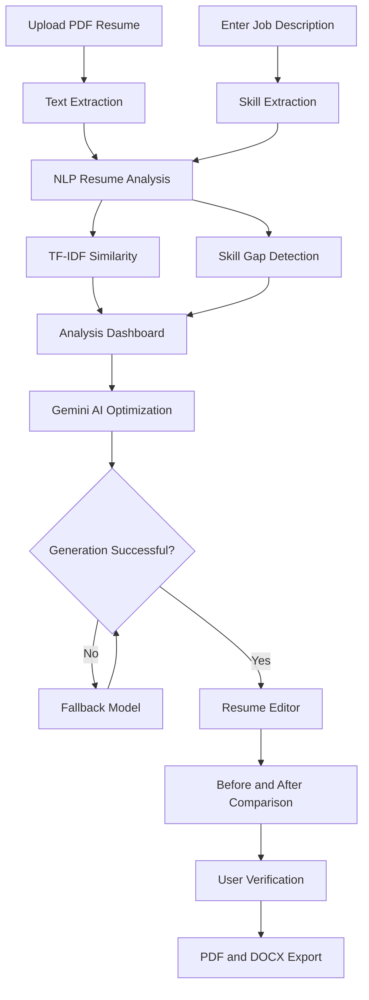

# ◈ HireLens AI 2.0

### AI-Powered Resume Intelligence Platform

> Analyze smarter. Optimize intelligently. Apply confidently.
> 
## 🌐 Live Demo

[](https://hirelens-ai-riya.streamlit.app/)

🚀 **Try HireLens AI:** https://hirelens-ai-riya.streamlit.app/

Analyze your resume, identify skill gaps, and generate
AI-powered tailored resumes in PDF and DOCX formats.


## 🚀 Overview


HireLens AI is an intelligent resume analysis and
optimization platform that helps job seekers understand
how their resumes align with specific job descriptions.

It combines Natural Language Processing, Machine Learning
and Generative AI to identify skill gaps, provide
personalized recommendations, and generate tailored,
ATS-friendly resumes.

Built as **Day 01 of my 30 Days of Data & AI Challenge**.

## 🌐 Live Demo

Deployment coming soon.

## ✨ Key Features

- **Resume Analysis:** Extract and analyze text from PDF resumes.
- **Job Compatibility:** Calculate TF-IDF cosine similarity.
- **Skill Matching:** Identify matching and missing technical skills.
- **Skill Gap Detection:** Discover areas for improvement.
- **AI Resume Optimization:** Tailor resumes using Google Gemini.
- **Automatic Model Fallback:** Handle temporary API failures.
- **Resume Editor:** Review and edit AI-generated content.
- **Before & After Comparison:** Compare original and optimized resumes.
- **ATS-Friendly Resume Builder:** Generate clean, single-column resumes.
- **PDF & DOCX Export:** Download customized resumes.
- **Premium Dashboard:** Modern, responsive Streamlit interface.

## 📸 Application Screenshots

Screenshots will be added after deployment.

## 🧠 How It Works



## 🛠️ Technology Stack

| Technology | Purpose |
|---|---|
| Python | Core application development |
| Streamlit | Interactive web interface |
| HTML & CSS | Custom frontend styling |
| Scikit-learn | TF-IDF and cosine similarity |
| NLP & Regex | Skill extraction and matching |
| Google Gemini API | Generative AI optimization |
| PyPDF | PDF text extraction |
| ReportLab | PDF resume generation |
| Python-docx | Word resume generation |
| Python-dotenv | Environment configuration |
| Git & GitHub | Version control |

## 📂 Project Structure

```text
HireLens-AI/
│
├── app.py
├── analyzer.py
├── resume_optimizer.py
├── resume_generator.py
├── style.css
├── requirements.txt
├── README.md
├── .gitignore
│
└── .streamlit/
    └── config.toml
```

## ⚙️ Installation & Setup

### 1. Clone the repository

```bash
git clone https://github.com/Riyarathore12/HireLens-AI.git
cd HireLens-AI
```

### 2. Create a virtual environment

```bash
python -m venv .venv
```

Windows:

```powershell
.venv\Scripts\Activate.ps1
```

Linux / macOS:

```bash
source .venv/bin/activate
```

### 3. Install dependencies

```bash
pip install -r requirements.txt
```

### 4. Configure Gemini API

Get your API key from:

https://aistudio.google.com/apikey

Create a `.env` file in the project directory:

```env
GEMINI_API_KEY=your_api_key_here
GEMINI_MODEL=gemini-3.5-flash-lite
```

Alternatively, enter your API key directly in the
application sidebar.

Never commit your API key to GitHub.

### 5. Run the application

```bash
python -m streamlit run app.py
```

Open:

http://localhost:8501

## 📊 Resume Analysis Methodology

### Text Similarity

TF-IDF converts resume and job description text
into numerical vectors. Cosine similarity measures
the textual alignment between these vectors.

### Skill Coverage

Skill coverage is calculated as:

```text
Skill Coverage =
(Matched Job Skills / Total Detected Job Skills) × 100
```

### Skill Gap Detection

The application identifies skills present in the
job description but not detected in the resume.

### Generative AI Optimization

Gemini rewrites and prioritizes existing resume
content according to the target job description.

The optimizer includes retry and fallback mechanisms
to handle temporary model availability issues.

## 🔐 Privacy & Responsible AI

- API keys are not committed to the repository.
- Resume optimization requires user consent.
- Resume content and job descriptions are sent to
  Gemini only when AI optimization is requested.
- AI instructions prohibit fabricated qualifications,
  skills, achievements and employment history.
- Users must verify generated content before export.
- Resume analysis scores are estimates, not official
  ATS scores or guarantees of job selection.

## ⚠️ Limitations

- Scanned PDFs may require OCR before analysis.
- Keyword-based skill detection may miss synonyms
  or context-dependent skills.
- Gemini generation depends on API availability
  and usage limits.
- AI-generated information requires manual verification.
- DOCX pagination may vary across document editors.
- Original resume formatting is not preserved.

## 🔮 Future Enhancements

- OCR support for scanned resumes
- Multiple resume templates
- Semantic skill matching using embeddings
- Multi-provider AI support
- Automated factual consistency validation
- Cover letter generation
- Job recommendation engine
- Interview preparation assistant

## 📅 30 Days of Data & AI Challenge

| Day | Project | Status |
|---|---|---|
| Day 01 | HireLens AI - Resume Intelligence Platform | Completed |

Building practical projects across Artificial
Intelligence, Machine Learning, Data Analytics
and Generative AI.

## 👩‍💻 Developer

**Riya Rathore**

Integrated M.Tech - Computational and Data Science  
VIT Bhopal University

- GitHub: [Riyarathore12](https://github.com/Riyarathore12)
- LinkedIn: [Riya Rathore](https://www.linkedin.com/in/riya-rathore18)
- 

---

⭐ If you find this project useful, consider starring
the repository.

**Built with Python, Machine Learning and Generative AI.**
